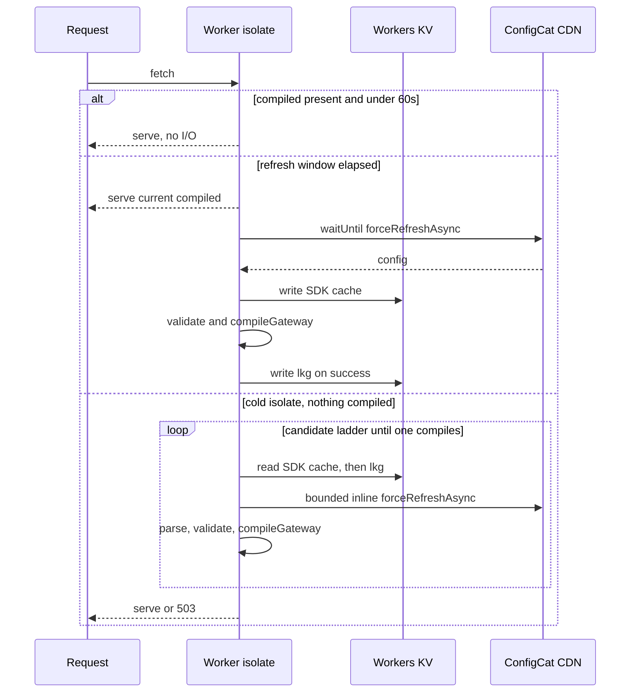

# Design: ConfigCat as the gateway configuration source

Status: confirmed, not yet implemented
Date: 2026-08-24

## Summary

Replace the statically bundled `src/config.json` with a single ConfigCat Text
setting holding the whole routing document. The worker fetches it through the
ConfigCat SDK in ManualPoll mode, validates it, compiles it, and caches the
result per isolate. Workers KV backs both the SDK cache and a separate
validated last-known-good copy.

Target propagation time for a dashboard change is roughly 60 seconds.

## Goals

- Route table, upstream URLs, and CORS policy lists become editable without a
  deploy.
- A ConfigCat outage does not take the gateway down.
- A malformed dashboard edit does not take the gateway down.
- No added latency on the steady-state request path.

## Non-goals

- Per-user or per-request targeting. The setting is evaluated without a user
  object.
- Storing secrets in ConfigCat. Auth0 issuer and audience stay in worker vars.
- Keeping `src/config.json` in the repository as a source of truth.

## Current state

`src/index.ts:4` imports `config.json` and `src/index.ts:17` calls
`compileGateway` at module scope, synchronously. `executeGatewayRequest`
already receives the compiled gateway as a parameter, and the existing tests
build their own configs, so only the one import is affected in production code.

`compileGateway` at `src/gateway/compiler.ts:60` already throws on unknown
origin types, unknown policy names, unknown policy types, and any write method
lacking an `auth0jwt` policy.

## Architecture

Four participants: the worker isolate, the ConfigCat CDN, Workers KV, and the
existing compiler.

### New module

`src/config/source.ts` owns all ConfigCat and KV access.

Isolate-level state:

- `client`, the ConfigCat client, created on first request
- `compiled`, the last good `CompiledGateway`
- `lastRaw`, the raw JSON string that produced `compiled`
- `nextRefreshMs`, earliest time the next refresh may start
- `refreshInFlight`, the pending refresh promise or undefined
- `generation`, a counter incremented per refresh start

The client cannot be created at module scope, because the KV binding arrives on
`env`. `getClient` is keyed per SDK key, so calling it per request is safe.

### Request path

1. If `compiled` exists and `Date.now() < nextRefreshMs`, return it. No await,
   no KV read, no fetch.
2. Otherwise, if `refreshInFlight` is set, return `compiled` without scheduling
   anything. Otherwise start a refresh, store its promise in `refreshInFlight`,
   and hand it to `ctx.waitUntil`.
3. A cold isolate with no `compiled` resolves inline instead, per the candidate
   ladder below.

`nextRefreshMs` is set when a refresh settles, not when it starts:

- On success, `Date.now() + 60000 + jitter`, where jitter is a random 0 to
  15000 milliseconds. The jitter spreads refreshes so that many isolates do not
  hit the ConfigCat CDN in the same instant.
- On failure, `Date.now() + 5000`, so a transient error does not suppress
  retries for a full minute.

Guarding with `refreshInFlight` rather than a pre-set timestamp is what
prevents concurrent requests in one isolate from stacking refreshes. A
pre-set timestamp does not track work that is still running.

Effective propagation is therefore up to about 75 seconds rather than exactly
60. That is within the stated target.

### Background refresh

`forceRefreshAsync` under a deadline, then `getValueAsync`, then parse,
validate, and `compileGateway`. On success, swap `compiled` and `lastRaw`, then
write `lkg`.

The refresh captures `generation` at entry and discards its result if
`generation` has advanced by the time it completes. Without this, a slow
refresh can overwrite the result of a newer one that already finished.

Any throw leaves `compiled` untouched, logs an error, and applies the short
failure backoff.

`ctx.waitUntil` extends the isolate's lifetime past the response but does not
guarantee completion. A refresh cut short by eviction or the platform deadline
simply leaves `compiled` in place and the backoff unset, so the next request
retries. No state is corrupted by a truncated refresh.

### Cold start candidate ladder

Candidates are tried in order. Each is fully processed, meaning parsed,
schema-validated, and passed through `compileGateway`, before it is accepted.
A candidate that fails any step is discarded and the ladder continues.

1. `await client.getValueAsync(FLAG_KEY, SENTINEL)`, skipped if it returns the
   sentinel.
2. `lkg:<gatewayName>:gateway_config` from KV.
3. One bounded inline `forceRefreshAsync`, then `getValueAsync` again.
4. Deploy 1 only: the bundled `src/config.json`, passed as an explicit final
   candidate. Removed in deploy 2.

If every candidate fails, return undefined and the caller responds 503.

Processing each candidate completely before accepting it is what makes the
malformed-config row of the failure matrix true. Selecting a candidate first
and validating afterward, as an earlier draft of this design did, lets a
malformed non-sentinel value from ConfigCat shadow a perfectly good `lkg` and
produce a 503.

The bundled document is an explicit final candidate rather than the
`getValueAsync` default. Using it as the default makes a cache miss
indistinguishable from a real ConfigCat value, which would mask both the `lkg`
and refresh candidates and make deploy 1 unable to demonstrate that config
actually came from ConfigCat.

Step 3 is worth its latency only because it is the last chance to avoid a 503.
It is bounded by an SDK request timeout and is never used merely to improve
freshness on an isolate that already has a usable candidate.

### Why ManualPoll

`ManualPollConfigService.getConfigAsync` calls `syncUpWithCache`, which calls
`cache.get` on the external cache on every invocation. Calling `getValueAsync`
per request would therefore mean a KV read per request. Gating on the
isolate-local `lastRefreshMs` instead reduces this to one KV read and one CDN
fetch per isolate per minute, both off the request path.

AutoPoll was rejected because Workers freeze between requests and background
timers do not run reliably. LazyLoad was rejected because its TTL expiry makes
one request per minute per isolate block on the CDN fetch.

## Data model

### ConfigCat setting

- Key `gateway_config`, type Text.
- Value is the current routing document, minified. Measured at 5441 bytes.

Open item: confirm ConfigCat's maximum Text setting length before implementing.
5441 bytes is small, but the ceiling has not been verified.

### Bindings

- `CONFIGCAT_SDK_KEY`, a secret, set with `wrangler secret put`.
- `GATEWAY_CONFIG`, a KV namespace binding added to `wrangler.toml`.

Both are added to the `Env` interface at `src/index.ts:9`.

### KV keys

One namespace, two prefixes, both scoped by gateway:

- `cc:<gatewayName>:<sdkCacheKey>` for the SDK's own cache, via a custom
  `IConfigCatCache`. The SDK supplies the trailing key string to `get` and
  `set`. Reads pass `cacheTtl: 60` so repeat reads in a colo hit Cloudflare's
  edge cache.
- `lkg:<gatewayName>:gateway_config` for the validated last-known-good
  document.

`gatewayName` is the existing `GATEWAY_NAME` var, already present in
`wrangler.toml:18`. Scoping is required, not cosmetic: `wrangler.toml:3`
records that this worker is templated per gateway, so an unscoped key in a
shared KV namespace could serve one gateway another gateway's routes.
Resolution fails closed if `GATEWAY_NAME` is unset.

### Last-known-good write rule

`lkg` is written only when all of the following hold:

- The document came from the `scheduled` handler's CDN refresh, not from a
  request-path read, the KV SDK cache, or the bundled fallback.
- The raw document differs from the one already stored in `lkg`.
- Schema validation and `compileGateway` both succeeded.
- The ConfigCat config timestamp on the new document is newer than the
  timestamp stored alongside the existing `lkg` value.

The stored value is an envelope carrying the raw document and that timestamp.

Provenance qualification is what prevents last-known-good regression. Without
it, a delayed isolate that read an older config from the SDK's KV cache can
overwrite a newer `lkg`, and that rollback then persists into every future cold
start.

Correction, B-002: provenance alone did not remove write amplification. A 304
Not Modified response still gives the SDK a new fetch timestamp, which is the
first line of the serialized cache value, so every warm refresh rewrote both
the `cc:` cache key and `lkg`. The KV cache adapter now compares the serialized
value without that first line, and `lkg` skips byte-identical documents. Only
the `scheduled` handler writes KV; the request path reads it.

### Validation split

The JSON schema, checked with the already-installed `@cfworker/json-schema`,
covers shape only:

- `routes` and `policies` are required arrays.
- Each route requires `path`, `method`, `origin.type`, `policies.request`, and
  `policies.response`.
- `path` and `method` are strings. Both policy lists are arrays of strings.
- Each policy requires `name` and `type` as strings.
- `origin.options` and policy `options` are unconstrained, since each origin
  and policy owns its own option shape.

`compileGateway` then enforces semantics and throws on unknown origin types,
unknown policy names, unknown policy types, and write methods without an
`auth0jwt` policy.

The auth0 rule cannot live in the schema. JSON Schema cannot resolve a name in
`policies.request` against the `type` of an entry in the separate `policies`
array. It is already enforced in code at `src/gateway/compiler.ts:86`.

Enums for origin types, policy types, and methods are deliberately excluded
from the schema. `compileGateway` already rejects unknown values, and
duplicating those lists creates drift as soon as an origin is added.

## Observability

Every successful resolution logs the adopted candidate and a short hash of the
document, through the existing `emitGatewayLog` path in
`src/gateway/logging.ts`. Candidate values are `configcat`, `lkg`,
`inline-refresh`, and `bundled`.

Without this, deploy 1 cannot be verified. When the ConfigCat setting and the
bundled document are byte-identical, which is exactly the state deploy 1 starts
in, behavior alone cannot distinguish a working ConfigCat path from a silent
fallback to the bundle.

Every discarded candidate logs at error level with the reason, so a malformed
dashboard edit is visible even though it causes no user-facing failure.

## Failure matrix

| Condition | Behavior | Impact |
|---|---|---|
| CDN down, isolate warm | Background refresh fails and logs. `compiled` retained. | None |
| CDN down, isolate cold, SDK cache in KV populated | `getValueAsync` returns cached config. Compile and serve. | None |
| CDN down, isolate cold, SDK cache empty | Sentinel returned. Ladder falls to `lkg`. Compile and serve. | None |
| CDN down, isolate cold, every candidate empty | Nothing to serve. | 503 |
| Malformed config, isolate warm | Schema or `compileGateway` throws. `compiled` retained, error logged, short backoff applied. | None |
| Malformed config, isolate cold | Candidate 1 is discarded on validation failure. Ladder falls to `lkg`. | None |
| KV down, isolate warm | SDK logs a cache read error and keeps its in-memory config. `compiled` retained. | None |
| KV down, isolate cold | Candidates 1 and 2 unavailable. Bounded inline `forceRefreshAsync` recovers. | One slow request |
| Refresh truncated by isolate eviction | `compiled` retained, backoff unset. Next request retries. | None |
| Slow refresh completes after a newer one | Generation counter has advanced, so the stale result is discarded. | None |

The malformed-config rows are the reason `lkg` exists as a separate key. A bad
dashboard edit is written into the SDK's KV cache as a legitimate config,
because the SDK validates ConfigCat's envelope rather than the routing
document. Only `lkg` is gated on the schema plus a successful `compileGateway`.

## Local development

With `config.json` deleted, `wrangler dev` requires a real SDK key from a
separate ConfigCat environment, stored in `.dev.vars`. Add `.dev.vars` to
`.gitignore`, which currently lists only `node_modules/`, `dist/`, and `.env`.

Local development now requires network access to ConfigCat. That is the direct
cost of removing the bundled file.

## Migration

Deploy 1:

1. Create the ConfigCat setting `gateway_config`, type Text, populated with the
   minified current config in every environment.
2. Create the KV namespace and add the binding to `wrangler.toml`.
3. `wrangler secret put CONFIGCAT_SDK_KEY`.
4. Ship `src/config/source.ts` with `src/config.json` still bundled as the
   explicit final candidate in the ladder. The sentinel default is in place
   from the start, so deploy 1 exercises the same resolution algorithm that
   deploy 2 will run.
5. Verify in production, using the adopted-source log line, that config
   resolved from ConfigCat rather than the bundled candidate, and that
   `lkg:<gatewayName>:gateway_config` is populated in KV.

Deploy 2:

1. Delete `src/config.json` and remove the final ladder candidate.
2. Update docs.

The extra deploy removes the window where a bootstrap mistake produces a hard
503 with no bundled config to fall back on. The end state is unchanged.

Rollback after deploy 2 is `wrangler rollback`, which restores a bundle that
still contains the file.

## Testing

`resolveGateway(env, ctx, dependencies)` takes injected dependencies, matching
the `ExecutionDependencies` pattern at `src/gateway/runtime.ts:127` that the
existing tests already drive. Fake KV is a `Map`-backed object exposing `get`
and `put`.

New cases:

- Schema rejects a document missing `routes`, and one where `policies.request`
  is not an array.
- Validation failure with a warm isolate keeps serving the previous gateway.
- Validation failure on a cold isolate compiles from `lkg`.
- Sentinel plus empty `lkg` plus a failed inline refresh yields 503.
- Two requests inside 60 seconds trigger exactly one refresh.
- A successful compile writes `lkg` through `waitUntil`.

Existing tests need no changes, since they call `compileGateway` and
`executeGatewayRequest` directly.

## Documentation updates

- `README.md` lines 29, 34, 333, 474.
- `docs/diagrams/architecture.mmd:6`.
- `docs/diagrams/README.md:7`.

`README.md:29` references `src/config.simple.json`, which does not exist. That
staleness predates this change and is resolved incidentally.

## Accepted risks

- Route paths, methods, upstream URLs, and the auth0 requirement become
  editable from a dashboard with no code review and no version history. Schema
  validation plus `compileGateway` prevent a malformed edit from breaking the
  gateway, but they cannot prevent a well-formed edit that is wrong, such as
  pointing a route at the wrong upstream.
- Refresh fan-out. One refresh per isolate per minute means traffic spread
  across many isolates produces proportional load on the ConfigCat CDN, with
  rate limiting a possible result. B-002 centralized refreshes in a one-minute
  Cron Trigger; request isolates read `lkg` from KV and reach the CDN only on
  a cold start with no valid `lkg`.
- Under very low traffic, most isolates are cold and serve whatever KV holds.
  Staleness stays bounded near 60 seconds plus KV eventual consistency, because
  the scheduled refresh writes fresh config to KV for the next cold isolate.

## Open items

- Confirm ConfigCat's maximum Text setting length.
- Confirm that `getValueAsync` in ManualPoll returns a config populated in the
  external cache by another isolate without a prior `forceRefreshAsync`. Source
  reading indicates it does, since `getConfigAsync` calls `syncUpWithCache`.
  The `lkg` fallback makes the design correct either way.
