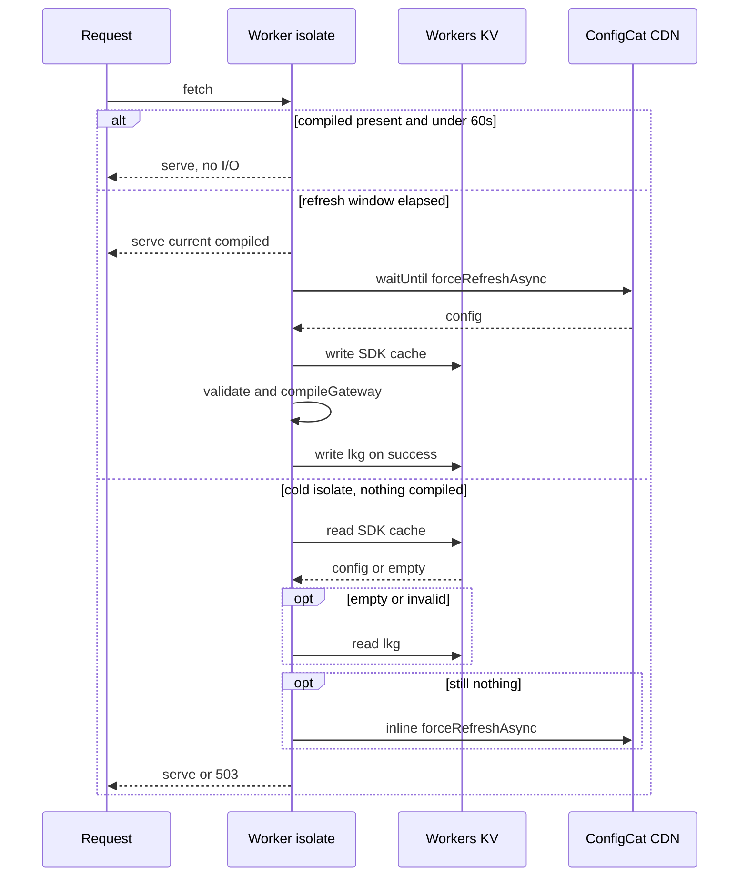

# Design: ConfigCat as the gateway configuration source

Status: confirmed, not yet implemented
Date: 2026-08-24

## Summary

Replace the statically bundled `src/config.json` with a single ConfigCat Text
setting holding the whole routing document. The worker fetches it through the
ConfigCat SDK in ManualPoll mode, validates it, compiles it, and caches the
result per isolate. Workers KV backs both the SDK cache and a separate
validated last-known-good copy.

Target propagation time for a dashboard change is roughly 60 seconds.

## Goals

- Route table, upstream URLs, and CORS policy lists become editable without a
  deploy.
- A ConfigCat outage does not take the gateway down.
- A malformed dashboard edit does not take the gateway down.
- No added latency on the steady-state request path.

## Non-goals

- Per-user or per-request targeting. The setting is evaluated without a user
  object.
- Storing secrets in ConfigCat. Auth0 issuer and audience stay in worker vars.
- Keeping `src/config.json` in the repository as a source of truth.

## Current state

`src/index.ts:4` imports `config.json` and `src/index.ts:17` calls
`compileGateway` at module scope, synchronously. `executeGatewayRequest`
already receives the compiled gateway as a parameter, and the existing tests
build their own configs, so only the one import is affected in production code.

`compileGateway` at `src/gateway/compiler.ts:60` already throws on unknown
origin types, unknown policy names, unknown policy types, and any write method
lacking an `auth0jwt` policy.

## Architecture

Four participants: the worker isolate, the ConfigCat CDN, Workers KV, and the
existing compiler.

### New module

`src/config/source.ts` owns all ConfigCat and KV access.

Isolate-level state:

- `client`, the ConfigCat client, created on first request
- `compiled`, the last good `CompiledGateway`
- `lastRaw`, the raw JSON string that produced `compiled`
- `lastRefreshMs`, timestamp of the last refresh trigger

The client cannot be created at module scope, because the KV binding arrives on
`env`. `getClient` is keyed per SDK key, so calling it per request is safe.

### Request path

1. If `compiled` exists and `Date.now() - lastRefreshMs < 60000`, return it.
   No await, no KV read, no fetch.
2. Otherwise set `lastRefreshMs` first, then schedule a background refresh
   through `ctx.waitUntil`. Setting the timestamp before the call prevents
   concurrent requests in one isolate from stacking refreshes.
3. A cold isolate with no `compiled` resolves inline instead, per the cold
   start sequence below.

### Background refresh

`forceRefreshAsync`, then `getValueAsync`, then validate, then
`compileGateway`, then swap `compiled` and `lastRaw`, then write `lkg`.

Any throw leaves `compiled` untouched and logs an error.

### Cold start resolution

1. `raw = await client.getValueAsync(FLAG_KEY, SENTINEL)`.
2. If `raw` is the sentinel, read `lkg:gateway_config` from KV.
3. If still empty, attempt one inline `forceRefreshAsync` and retry step 1.
4. If still empty, return undefined. The caller responds 503.
5. Validate, compile, assign `compiled` and `lastRaw`, write `lkg` under
   `ctx.waitUntil`.

### Why ManualPoll

`ManualPollConfigService.getConfigAsync` calls `syncUpWithCache`, which calls
`cache.get` on the external cache on every invocation. Calling `getValueAsync`
per request would therefore mean a KV read per request. Gating on the
isolate-local `lastRefreshMs` instead reduces this to one KV read and one CDN
fetch per isolate per minute, both off the request path.

AutoPoll was rejected because Workers freeze between requests and background
timers do not run reliably. LazyLoad was rejected because its TTL expiry makes
one request per minute per isolate block on the CDN fetch.

## Data model

### ConfigCat setting

- Key `gateway_config`, type Text.
- Value is the current routing document, minified. Measured at 5441 bytes.

Open item: confirm ConfigCat's maximum Text setting length before implementing.
5441 bytes is small, but the ceiling has not been verified.

### Bindings

- `CONFIGCAT_SDK_KEY`, a secret, set with `wrangler secret put`.
- `GATEWAY_CONFIG`, a KV namespace binding added to `wrangler.toml`.

Both are added to the `Env` interface at `src/index.ts:9`.

### KV keys

One namespace, two prefixes:

- `cc:<sdkCacheKey>` for the SDK's own cache, via a custom `IConfigCatCache`.
  The SDK supplies the key string to `get` and `set`. Reads pass
  `cacheTtl: 60` so repeat reads in a colo hit Cloudflare's edge cache.
- `lkg:gateway_config` for the validated last-known-good document.

### Validation split

The JSON schema, checked with the already-installed `@cfworker/json-schema`,
covers shape only:

- `routes` and `policies` are required arrays.
- Each route requires `path`, `method`, `origin.type`, `policies.request`, and
  `policies.response`.
- `path` and `method` are strings. Both policy lists are arrays of strings.
- Each policy requires `name` and `type` as strings.
- `origin.options` and policy `options` are unconstrained, since each origin
  and policy owns its own option shape.

`compileGateway` then enforces semantics and throws on unknown origin types,
unknown policy names, unknown policy types, and write methods without an
`auth0jwt` policy.

The auth0 rule cannot live in the schema. JSON Schema cannot resolve a name in
`policies.request` against the `type` of an entry in the separate `policies`
array. It is already enforced in code at `src/gateway/compiler.ts:86`.

Enums for origin types, policy types, and methods are deliberately excluded
from the schema. `compileGateway` already rejects unknown values, and
duplicating those lists creates drift as soon as an origin is added.

## Failure matrix

| Condition | Behavior | Impact |
|---|---|---|
| CDN down, isolate warm | Background refresh fails and logs. `compiled` retained. | None |
| CDN down, isolate cold, SDK cache in KV populated | `getValueAsync` returns cached config. Compile and serve. | None |
| CDN down, isolate cold, SDK cache empty | Sentinel returned. Read `lkg`. Compile and serve. | None |
| CDN down, isolate cold, both KV keys empty | Nothing to serve. | 503 |
| Malformed config, isolate warm | Schema or `compileGateway` throws. `compiled` retained, error logged. | None |
| Malformed config, isolate cold | Validation fails. Fall through to `lkg`. | None |
| KV down, isolate warm | SDK logs a cache read error and keeps its in-memory config. `compiled` retained. | None |
| KV down, isolate cold | Sentinel, then `lkg` read fails. Inline `forceRefreshAsync` recovers. | One slow request |

The malformed-config rows are the reason `lkg` exists as a separate key. A bad
dashboard edit is written into the SDK's KV cache as a legitimate config,
because the SDK validates ConfigCat's envelope rather than the routing
document. Only `lkg` is gated on the schema plus a successful `compileGateway`.

## Local development

With `config.json` deleted, `wrangler dev` requires a real SDK key from a
separate ConfigCat environment, stored in `.dev.vars`. Add `.dev.vars` to
`.gitignore`, which currently lists only `node_modules/`, `dist/`, and `.env`.

Local development now requires network access to ConfigCat. That is the direct
cost of removing the bundled file.

## Migration

Deploy 1:

1. Create the ConfigCat setting `gateway_config`, type Text, populated with the
   minified current config in every environment.
2. Create the KV namespace and add the binding to `wrangler.toml`.
3. `wrangler secret put CONFIGCAT_SDK_KEY`.
4. Ship `src/config/source.ts` with `src/config.json` still bundled, used as
   the fallback value in place of the sentinel.
5. Verify in production that routes resolve from ConfigCat and that
   `lkg:gateway_config` is populated in KV.

Deploy 2:

1. Delete `src/config.json`.
2. Switch the fallback to the sentinel.
3. Update docs.

The extra deploy removes the window where a bootstrap mistake produces a hard
503 with no bundled config to fall back on. The end state is unchanged.

Rollback after deploy 2 is `wrangler rollback`, which restores a bundle that
still contains the file.

## Testing

`resolveGateway(env, ctx, dependencies)` takes injected dependencies, matching
the `ExecutionDependencies` pattern at `src/gateway/runtime.ts:127` that the
existing tests already drive. Fake KV is a `Map`-backed object exposing `get`
and `put`.

New cases:

- Schema rejects a document missing `routes`, and one where `policies.request`
  is not an array.
- Validation failure with a warm isolate keeps serving the previous gateway.
- Validation failure on a cold isolate compiles from `lkg`.
- Sentinel plus empty `lkg` plus a failed inline refresh yields 503.
- Two requests inside 60 seconds trigger exactly one refresh.
- A successful compile writes `lkg` through `waitUntil`.

Existing tests need no changes, since they call `compileGateway` and
`executeGatewayRequest` directly.

## Documentation updates

- `README.md` lines 29, 34, 333, 474.
- `docs/diagrams/architecture.mmd:6`.
- `docs/diagrams/README.md:7`.

`README.md:29` references `src/config.simple.json`, which does not exist. That
staleness predates this change and is resolved incidentally.

## Accepted risks

- Route paths, methods, upstream URLs, and the auth0 requirement become
  editable from a dashboard with no code review and no version history. Schema
  validation plus `compileGateway` prevent a malformed edit from breaking the
  gateway, but they cannot prevent a well-formed edit that is wrong, such as
  pointing a route at the wrong upstream.
- Each cold isolate writes the same `lkg` key once. KV allows one write per
  second per key, so a burst of cold starts drops some writes. Those failures
  are swallowed and harmless, because the value written is identical. An ETag
  guard can be added later if it ever matters.
- Under very low traffic, most isolates are cold and serve whatever KV holds.
  Staleness stays bounded near 60 seconds plus KV eventual consistency, because
  background refreshes write fresh config back to KV for the next cold isolate.

## Open items

- Confirm ConfigCat's maximum Text setting length.
- Confirm that `getValueAsync` in ManualPoll returns a config populated in the
  external cache by another isolate without a prior `forceRefreshAsync`. Source
  reading indicates it does, since `getConfigAsync` calls `syncUpWithCache`.
  The `lkg` fallback makes the design correct either way.
